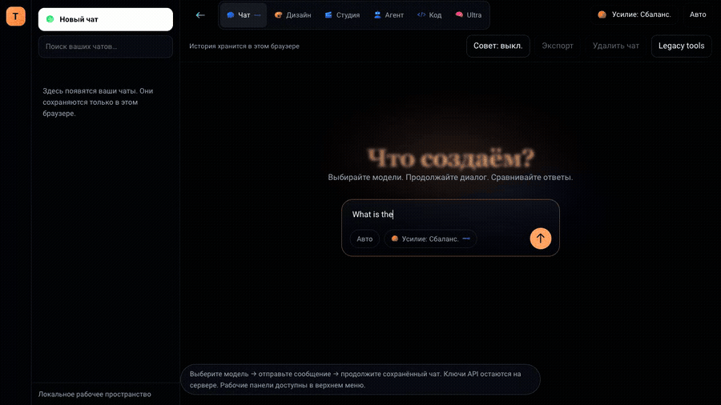
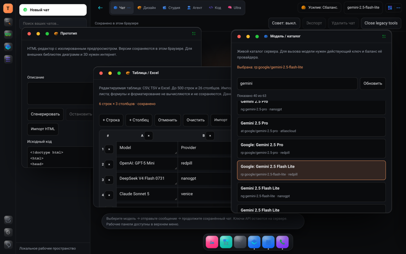
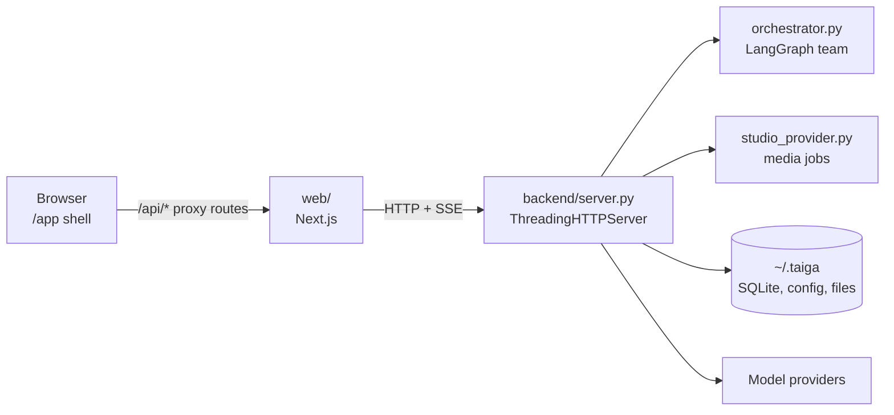
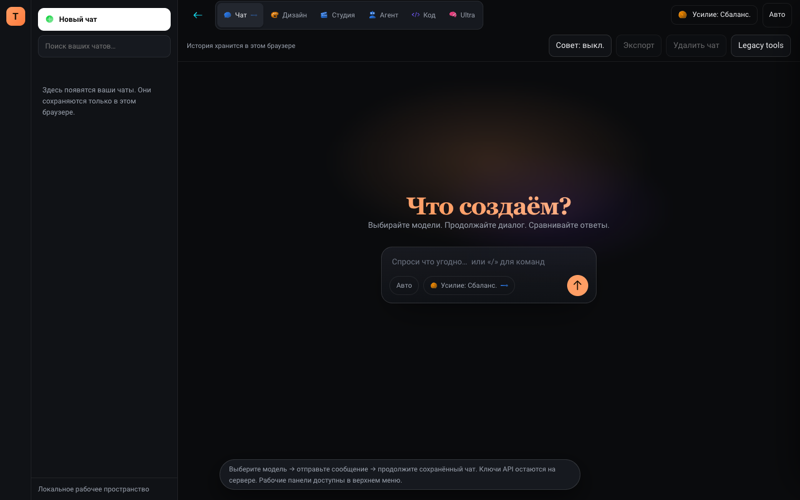
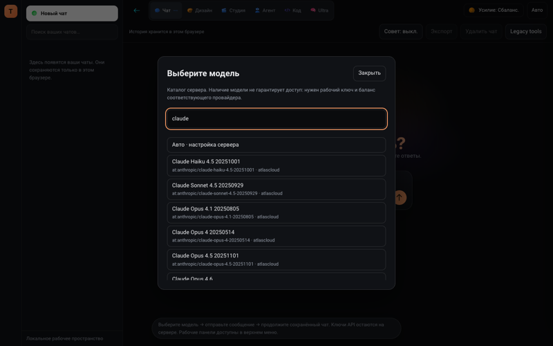
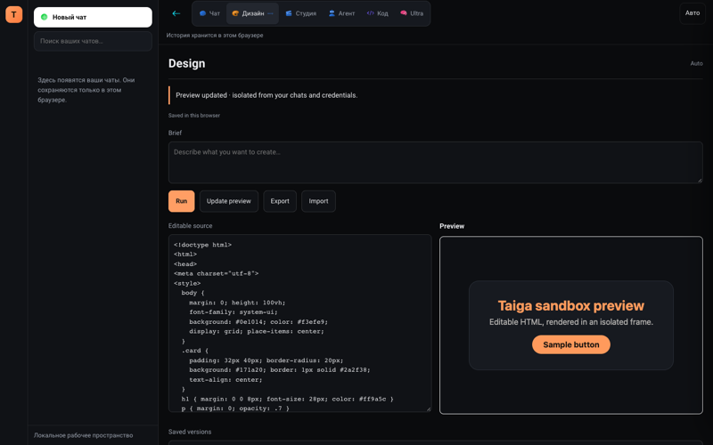
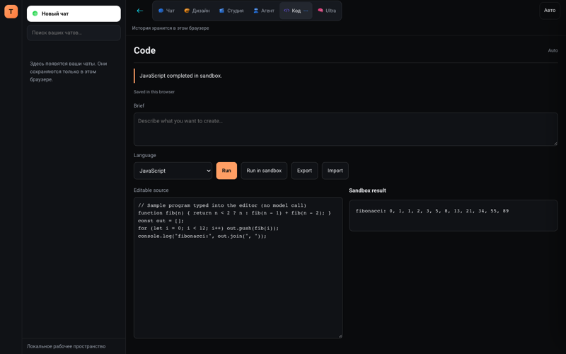

# Taiga

> **Public demo repository.** README, screenshots and a recorded demo only: the app needs a Python backend and provider keys, so there is no clickable live demo. **Source code is private; available on request** (zalyatovdamiredominic@gmail.com).

Taiga is a private multi-model AI workspace: chat, design, code, agent teams and a media
studio in one window. A Next.js front end talks to a Python HTTP/SSE back end that holds
the provider keys.

Recorded against the backend's offline test fixture, so no provider was called; the chat reply is the fixture's canned answer.

## What it does

- **Chat** — pick a model and provider from the live catalogue, keep searchable history, run a two-model council, stop a response, export to Markdown.
- **Design / Code** — generate HTML in a sandboxed preview; run JavaScript in an isolated worker with a five-second limit.
- **Agents** — a LangGraph planner splits a task; role-based workers run in parallel or in sequence.
- **Studio** — image, video, voice, music and 3D jobs with resumable status polling and no automatic resubmission.
- **Retrieval** — hybrid (embeddings + keywords) or keyword-only search over uploaded documents and past chats.
- **Providers** — Venice, NanoGPT, Chutes, Redpill, AIML API and Atlas Cloud behind one endpoint, plus an OpenAI-compatible `POST /v1/chat/completions`.

## Architecture

| Folder | What | Details |
| --- | --- | --- |
| `web/` | Next.js 16, React 19, TypeScript, Tailwind CSS 4, Vitest |
| `backend/` | Python 3.12, standard-library `http.server`, SQLite, LangGraph |

## Screens

| | |
|---|---|
|  |  |
|  |  |

## Stack

Web: Next.js 16, React 19, TypeScript, Tailwind CSS 4, Vitest. Backend: Python 3.12 on the standard-library `http.server`, SQLite, LangGraph. Provider keys stay on the backend; the browser only talks to `/api/*` proxy routes.

## Tests

Counts from the private source repository's test files (not re-run for this page): the web side has 95 Vitest cases in 7 files (tool-risk decisions, retrieval ranking, chat message tree, SSE streaming and error handling, usage log, money formatting, panel API); the backend has 47 test functions in 6 files (HTTP contract tests, catalogue routes, orchestrator regressions, studio jobs, a fixture suite that replaces providers with a local test double, and a live-provider test that needs paid keys). CI runs both suites on each push that touches the matching folder, plus type check, lint and build for the web side.

## Status / limits

A portfolio application and a tested single-process prototype for local or trusted use, not a hardened multi-user service.
Chats live in the browser's local storage; live provider results depend on paid keys and on the models providers currently serve.

Author: Damire Zalyatov · [MIT License](LICENSE). The demo recording used the offline test fixture; no real user data or provider calls.
